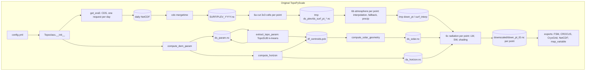

# How the tool works: original TopoPyScale vs our modified Zarr version

Written 2026-10-15. It explains the code: what each part does, what it reads and writes, and why it
exists. The decisions and evidence behind our changes are in the fork's `PROGRESS.md`. The current
settings are in `DESIGN.md` ("Current design").

- **Part A**: the original tool, as written by the authors (upstream TopoPyScale, fork base commit
  `8668a5b`, before any of our changes).
- **Part B**: the modified version we run: our fork of the library (commit `7d54b9a` plus the
  2026-10-13 changes) and the `zarr_workflow/` scripts in this repo.
- **Part C**: notes for drawing the two UML diagrams.

Function and file names are given so you can find them in the code. Line numbers are left out
because they change.

---

# Part A: the original TopoPyScale

## A.1 What the tool does, in one paragraph

ERA5 has a resolution of about 25 to 30 km (0.25°). One ERA5 cell covers whole valleys and ridges,
so its temperature, radiation and precipitation are "average mountain" values. TopoPyScale turns
them into values for specific terrain (a 25 m pixel, or a group of similar pixels). It combines two
methods:

1. **TopoSUB** (Fiddes & Gruber 2012): instead of computing millions of DEM pixels, group pixels
   with similar terrain (position, elevation, slope, aspect, sky-view factor) into *k* clusters with
   k-means. Then compute only one representative point per cluster, its centroid.
2. **TopoSCALE** (Fiddes & Gruber 2014): for each point, take the ERA5 data around it and adjust it
   to the point's terrain. This means horizontal interpolation from the 3×3 ERA5 cells and vertical
   interpolation between pressure levels to the point's elevation (t, q, u, v, p). It also corrects
   precipitation with elevation, and computes longwave and shortwave radiation using the slope, the
   aspect, the sky-view factor, the sun position and terrain shading.

The result is one hourly time series per point. A map is made by giving every pixel its cluster's
value.

## A.2 Structure: one controlling class, many function modules

```
run script (user)            e.g. pipeline.py: mp = Topoclass('config.yml'); mp.get_era5(); ...
   │
   ▼
topoclass.Topoclass          reads the YAML config, holds all state, calls the modules in order
   ├── fetch_era5.FetchERA5  ERA5 download (Copernicus CDS API)
   ├── fetch_dem             DEM download (only if no DEM file is given)
   ├── topo_param            terrain parameters (slope, aspect, svf), horizon angles, point sampling
   ├── topo_sub              k-means clustering (TopoSUB)
   ├── solar_geom            sun position per point and timestep (pvlib)
   ├── topo_scale            the downscaling physics (TopoSCALE), "classic" NetCDF path
   ├── topo_scale_zarr       the authors' newer, experimental Zarr path (see A.6)
   ├── meteo_util            humidity / vapour pressure / snow partition helpers
   ├── topo_utils            parallel pools, dataframe helpers, reading outputs
   ├── topo_export           writing to NetCDF and to model formats (FSM, CROCUS, CryoGrid, ...)
   └── topo_plot (Plotting)  maps: cluster value → pixels (map_variable)
```

The library has almost no classes. `Topoclass` is the only real object. Everything else is plain
functions that receive data and return or write data. The **files on disk are the interface between
steps**: each step writes a file, and the next step (or a rerun) reads it back.

## A.3 The pipeline, step by step

A typical authors' run script calls, in this order:

```python
mp = Topoclass('config.yml')       # step 0
mp.get_era5()                      # step 1
mp.compute_dem_param()             # step 2
mp.extract_topo_param()            # step 3
mp.compute_solar_geometry()        # step 4
mp.compute_horizon()               # step 5
mp.downscale_climate()             # step 6
mp.to_netcdf() / mp.to_fsm() ...   # step 7 (exports)
```

### Step 0: `Topoclass.__init__(config_file)` sets up the project

| What it does | Why it is needed |
|---|---|
| Reads the YAML into `self.config` (a `DefaultMunch`, so missing keys give `None` instead of an error) | Every later step takes its settings from here. |
| Builds the paths `outputs/`, `outputs/tmp/`, `outputs/downscaled/`, `climate.path`, `climate/tmp/` and creates the folders | Fixed project layout. All caches and results go into known places. |
| `clean_outputs: True` deletes the whole outputs folder | Otherwise old per-point NetCDF files would be concatenated with new ones. |
| If the DEM file is missing: `fetch_dem.fetch_dem(...)` downloads one for `project.extent` | Lets a user start from just a bounding box. |
| Extent: from the config, or from the DEM (`topo_param.get_extent_latlon`) | Needed for the ERA5 download box. |
| Creates `self.toposub` (holds `ds_param`, `df_centroids`), `self.plot`, `self.era5_obj = FetchERA5(config)` | State that the later steps fill in. |
| `project.split.IO`: `TimeSplitter` (splits the period into multi-year chunks) | Long periods in pieces. NetCDF only, and the authors themselves mark it as untested. |

### Step 1: `get_era5()` downloads the climate input (CDS)

`Topoclass.get_era5` → `FetchERA5.go_fetch('all')` → `retrieve_era5(...)` twice (surface, then
pressure levels).

| Function | What it does | Why |
|---|---|---|
| `go_fetch` | Download box = extent **+0.4°** on each side. Reads timestep, levels and format from the config. Only `data_repository: cds` is accepted. | TopoSCALE needs the 3×3 ERA5 cells *around* every point, so the box must be larger than the DEM. |
| `retrieve_era5` | Makes a table of **days**. For each day missing on disk, one CDS request runs (`era5_request_surf` / `era5_request_plev`) in a thread pool. Writes `daily/dSURF_YYYYMMDD.nc` and `dPLEV_YYYYMMDD.nc`. | The CDS queue handles small requests well, and a rerun only fetches the missing days (simple resume). |
| `remap_CDSbeta` | Renames variables and dimensions of the new (2024) CDS NetCDF format back to the old names | The rest of the code expects the old names (`time`, `level`, ...). |
| `cdo mergetime` | Merges the daily files into `yearly/SURF_YYYY.nc` and `PLEV_YYYY.nc` | The downscaler opens the yearly files. |
| Variables | Surface: z, d2m, strd, ssrd, sp, tp, t2m. Levels: z, t, u, v, q, r | The minimum TopoSCALE needs. |

Output: yearly NetCDF files. The downscaler reads `PLEV*.nc` / `SURF*.nc` from `climate.path`.

### Step 2: `compute_dem_param()` computes the terrain parameters

`topo_param.compute_dem_param(dem_file, fname='ds_param.nc', ...)`

| What | Why |
|---|---|
| `open_dem`: reads the GeoTIFF into an xarray Dataset (`elevation` on x, y) | The DEM must be in a metric projection (UTM), because distances and gradients are in metres. |
| `topocalc.gradient.gradient_d8` → `slope`, `aspect` (radians), and `aspect_cos`, `aspect_sin` | Slope and aspect drive solar illumination. Aspect is split into cos and sin because it is circular: 359° and 1° are neighbours, and k-means must see that. |
| `topocalc.viewf.viewf` → `svf` (sky-view factor, 0–1) | The share of the sky a pixel sees. It scales diffuse SW and the LW from the sky, and (1 − svf) is the LW coming from the surrounding terrain. **This is the slow part** (single core, about 46 min for our DEM). |
| Writes `ds_param.nc` with `topo_export.to_netcdf` (floats **packed to int16**, 10-bit scale/offset) | A cache. If the file exists, it is reused and nothing is recomputed. |

### Step 3: `extract_topo_param()` chooses the points to downscale

If `df_centroids.pck` exists, it is loaded (cache). Otherwise one of three sampling methods runs:

**(a) `toposub`: `extract_topo_cluster_param()`, the clustering (TopoSUB)**

| Sub-step | Function | Why |
|---|---|---|
| Flatten every raster to a table, one row per pixel | `topo_sub.ds_to_indexed_dataframe(ds_param)` | k-means works on a table of samples × features. |
| Mask: drop nodata pixels, and keep only pixels where `clustering_mask` = 1 | rasterio read of the mask GeoTIFF; bounds and resolution must equal the DEM's | Cluster only the area of interest (for us, the mountains), not the lowlands. |
| Optional groups (`clustering_groups`, e.g. land cover): cluster each group separately, with k shared by pixel count | loop over groups | Clusters never mix, for example, forest and rock. |
| Standardise the features (z-score), then **multiply each by its weight** | `topo_sub.scale_df(df, features={'x':1,'y':1,'elevation':4,...})` | Features have different units. The weight makes a feature count more in the distance k-means minimises. |
| k-means | `kmeans_clustering` (sklearn `KMeans`) or `minibatch_kmeans_clustering` (`MiniBatchKMeans`, batch 256 × cores) | Mini-batch is much faster on millions of pixels. |
| Turn the centroids back into real units | `inverse_scale_df` | A centroid's elevation, slope etc. are the values used by TopoSCALE. |
| Average the other columns (e.g. lat/lon) per cluster, and name the clusters `point_name` (zero-padded) and `point_ind` | pandas groupby | Points need a name and an index for the output files. |
| Write the **cluster map** back into `ds_param` (`cluster_labels`, `point_name`, `point_ind` per pixel), then save `ds_param.nc` again | `np.reshape(..., order='F')`, `te.to_netcdf` | This map is what later turns point results into maps. (**Bug here, see B.3**: the order handling was wrong when a mask was used.) |

**(b) `points`: `extract_pts_param()`** reads a CSV of x/y points (e.g. weather stations) and
samples the terrain at each one (`topo_param.extract_pts_param`, nearest / idw / linear). We used
this for the 28 stations.

**(c) `grid`** uses every pixel as a point (only practical for tiny DEMs).

Then for all methods: `convert_epsg_pts` adds `lon`/`lat` (needed to find the ERA5 cells), and the
table is saved as **`df_centroids.pck`** (a pandas pickle).

### Step 4: `compute_solar_geometry()` computes the sun position per point and timestep

`solar_geom.get_solar_geom(df_centroids, start, end, tstep, ...)`

| What | Why |
|---|---|
| `pvlib.solarposition.get_solarposition` for each point (thread pool) over the whole period | The sun's zenith, azimuth and elevation are needed for the illumination angle and the shading test. |
| Derived: `mu0` = cos(zenith) (0 at night), `SWtoa` = 1370 · mu0 (top-of-atmosphere SW), `sunset` flag | Used for the clearness index, splitting SW into direct and diffuse, and night masking. |
| Writes `ds_solar.nc` (dims `point_name`, `time`) | Cache. Computed once per period. |

### Step 5: `compute_horizon()` computes horizon angles (terrain shading)

`topo_param.compute_horizon(dem_file, azimuth_inc, ...)`

| What | Why |
|---|---|
| `topocalc.horizon.horizon` for each azimuth sector (e.g. 36 sectors of 10°), for **every DEM pixel**, in a thread pool | The horizon angle tells whether a mountain blocks the sun: if the horizon in the sun's direction is higher than the sun, the point gets no direct SW. |
| Writes `da_horizon.nc` (azimuth × y × x; for our DEM about 7 GB) | Cache. |
| Samples the angles at each centroid → columns `hori_azi_<az>` in `df_centroids`, saved again | So the downscaler only needs 36 numbers per point, not the full array. (The classic downscaler still reads `da_horizon` anyway, see step 6.) |

### Step 6: `downscale_climate()` runs TopoSCALE (classic path, `topo_scale.py`)

`Topoclass.downscale_climate` chooses the path. If `climate.era5.zarr_store` is **not** set, it uses
the classic `topo_scale.downscale_climate(...)`, which works in three phases with temporary files:

**Phase 6a: cut the ERA5 data per point** (`_subset_climate_dataset`, thread pool)
- `xr.open_mfdataset` opens all yearly PLEV files, checks that every requested timestep exists, and
  selects the period.
- For each point, it finds the nearest ERA5 cell to the point's lat/lon and takes **that cell and its
  8 neighbours (3×3)**. It converts geopotential to metres (z / g) and writes
  `outputs/tmp/ds_plev_pt_<id>.nc`. The same is done for the surface data (`ds_surf_pt_<id>.nc`).
- Why: the big ERA5 files are read once. Each later worker process then only opens two small files,
  which keeps memory low.

**Phase 6b: atmosphere per point** (`pt_downscale_interp`, `multicore_pooling` = process pool)

| Calculation | Why |
|---|---|
| Horizontal interpolation: inverse-distance weights (1/d², `idw`) of the 9 cells to the point (cell centres are projected to the DEM CRS) | Smooths the 0.25° grid to the point's exact location. |
| Humidity: surface dew point → q (`meteo_util.dewT_2_q_magnus`), and dew point on levels (`t_rh_2_dewT`) | Common humidity variables for the LW calculation. |
| **Vertical interpolation**: find the pressure levels just above and below the point's elevation (level heights `z` change every hour) and interpolate t, u, v, q linearly in height | This is the main temperature downscaling. The free-atmosphere profile replaces ERA5's smoothed surface. |
| **Fallback**: if the point is lower than the lowest level (1000 hPa) at some hours, take the lowest level's values (no extrapolation) and print a warning | Lowland points. For us these are 14 clusters. |
| Pressure `p` from the hypsometric equation | Needed for the radiation calculation. |
| Precipitation: `tp × tstep × 1000` (m → mm), optionally × the monthly elevation lapse-rate factor (Liston & Elder coefficients) | ERA5 precipitation is a cell mean. The lapse rate adds more precipitation with height. |
| Wind speed and direction from u, v | Output variables. |
| Writes `tmp/down_pt_<id>.nc` and `tmp/surf_interp_<id>.nc` | Phase 6c needs both. Files keep memory low between the phases. |

**Phase 6c: radiation per point** (`pt_downscale_radiations`, process pool)

| Calculation | Why |
|---|---|
| **LW**: clear-sky emissivity at the point (from its vapour pressure and t) + "cloud" emissivity from ERA5 (`strd / 3600` vs σT⁴ at the surface). LW = svf · ε · σT⁴ (+ terrain emission (1 − svf), if `LW_terrain_contribution`) | Colder, drier air at height emits less LW. Steep terrain emits LW towards the point. |
| **SW**: ERA5 `ssrd / 3600` → clearness index `kt` = SW / SWtoa → diffuse fraction `kd` (empirical formula) → diffuse and direct parts | Diffuse SW comes from the whole sky (scaled by svf). Direct SW depends on slope and aspect. |
| Direct SW to the point's height with Beer's law (optical depth from ERA5, path length from p) | Thinner atmosphere at height means more direct SW. |
| Illumination angle from the sun's zenith and azimuth and the point's slope and aspect (negative = self-shaded → 0) | A south slope gets more sun than a north slope. |
| **Shading**: the horizon angle in the sun's direction (from `da_horizon`, nearest azimuth) > sun elevation → direct SW = 0 | Cast shadows from the surrounding mountains. |
| `round(5)`, attributes, write **`outputs/downscaled/down_pt_<id>.nc`** (one NetCDF per point) | Final product of the classic path. |

Afterwards, `tu.read_downscaled` opens all `down_pt_*.nc` as one dataset (`open_mfdataset`,
concatenated along `point_name`) into `mp.downscaled_pts`, and `rm_tmp_dirs` deletes `tmp/`.

### Step 7: exports and maps

- `to_netcdf`, `to_fsm`, `to_crocus`, `to_cryogrid`, `to_snowpack`, `to_surfex`, `to_geotop`,
  `to_musa`, `to_snowmodel` (`topo_export.py`): convert the point time series into the input formats
  of snow and permafrost models. That is the authors' main use case: TopoPyScale produces **forcing
  for land-surface models**.
- `Plotting.map_variable` (`topo_plot.py`): picks one timestep and gives every pixel the value of its
  cluster (via `ds_param.point_name`). This is the "point → map" step. In our project it became the
  daily GeoTIFF export.

## A.4 Supporting modules (used by all steps)

| Module | Role | Why it exists |
|---|---|---|
| `meteo_util` | `dewT_2_q_magnus`, `t_rh_2_dewT`, `mixing_ratio`, `vapor_pressure`, `q_2_rh`, `partition_snow` | Physics helpers shared by the downscaler and the exporters. **Watch out:** they write fixed variable names (`q`, `vp`, `w`) into the dataset they get. |
| `topo_utils` | `multicore_pooling` (process pool), `multithread_pooling` (thread pool), `ds_to_indexed_dataframe`, `read_downscaled`, `get_versionning` | One place for parallelism and conversions. |
| `topo_export.to_netcdf` | Writes datasets with floats packed to int16 (scale/offset, 10 bits) | Smaller cache files. Side effect: values are quantised (elevation in steps of about 2.8 m for our DEM). |

## A.5 Files on disk (original)

| File | Made by | Read by | Content |
|---|---|---|---|
| `climate/daily/dSURF_*.nc`, `dPLEV_*.nc` | step 1 | step 1 (merge) | one day of ERA5 each |
| `climate/yearly/SURF_YYYY.nc`, `PLEV_YYYY.nc` | step 1 | step 6 | ERA5 per year |
| `outputs/ds_param.nc` | steps 2, 3 | 3, 7 | terrain + cluster map, per pixel |
| `outputs/df_centroids.pck` | steps 3, 5 | 4, 5, 6, 7 | one row per point: terrain, lat/lon, horizon angles |
| `outputs/ds_solar.nc` | step 4 | 6 | sun position, point × time |
| `outputs/da_horizon.nc` | step 5 | 6 | horizon angles, azimuth × pixel |
| `outputs/tmp/ds_{plev,surf}_pt_<id>.nc`, `down_pt_<id>.nc`, `surf_interp_<id>.nc` | 6a, 6b | 6b, 6c | 4 temporary files per point (2000 for k = 500) |
| `outputs/downscaled/down_pt_<id>.nc` | 6c | 7 | final hourly series, one file per point |

## A.6 The authors' own Zarr path (already in upstream, unfinished)

Upstream already contained the start of a Zarr version. **We did not invent the Zarr path; we
repaired and extended it.**

- `fetch_era5.FetchERA5.to_zarr` / `convert_netcdf_stack_to_zarr`: converts the downloaded yearly
  NetCDF files into one `ERA5.zarr` (their warning: needs a lot of memory).
- `fetch_era5.fetch_era5_google_from_zarr`: reads ARCO-ERA5 from Google Cloud (not wired into the
  pipeline).
- `topo_scale_zarr.ClimateDownscaler` (S. Filhol, 2025): opens `ERA5.zarr` once and, for each point,
  reads the 3×3 cells, runs the whole physics in memory (no temporary files) and writes either one
  NetCDF per point or one region of an output Zarr store. Parallelism: a multiprocessing pool or Dask.
- `Topoclass.downscale_climate` uses it when `climate.era5.zarr_store` is set.
- Its own TODO list says it is unfinished ("incorporate method into TopoClass", "make Dask worker
  parameters flexible"). When we tested it, it could not run correctly (list in B.3).

## A.7 Why we could not use the original as it is

| Limitation | Effect for us |
|---|---|
| ERA5 only from CDS, day by day (`data_repository` other than `cds` → error) | Slow queue. Our data source is Earth Data Hub (EDH), which serves ERA5 as Zarr. |
| Classic downscaler: 4 temporary files per point, `clear_files(tmp)` at every start | No resume: a crash in point 480 of 500 means starting again. Many small files. |
| One output NetCDF per point | 500 files per run. A year cannot be filled month by month. |
| Zarr path: physics bugs + wiring bugs (B.3) | Could not be used without repairs. |
| Mask/cluster-map pixel order bug (B.3) | With a mask (our case), 25 % of the clustered pixels were outside the mask and the saved cluster map was scrambled. |
| Caches only as NetCDF; the existence check is `Path.is_file()` | A Zarr store is a folder, so it would never count as "exists". |
| No daily statistics, no GeoTIFF export, no QA | Our products are daily min/mean/max maps. |

---

# Part B: the modified version (fork + `zarr_workflow`)

## B.1 What stayed the same and what changed

**Same as the original (science):**
- TopoSUB: same features, scaling, mini-batch k-means and centroid handling.
- Terrain parameters, solar geometry and horizon algorithms: unchanged functions.
- TopoSCALE physics: unchanged. Our Zarr downscaler gives the **same numbers as the classic
  `topo_scale.py`**: all 16 output variables agree within 1e-5
  (`tests/test_topo_scale_zarr_parity.py`).

**Changed (data handling, robustness, products):**
1. ERA5 comes from **Earth Data Hub** (Zarr on a server) instead of CDS.
2. All intermediate files can be **Zarr** (`ds_param`, `ds_solar`, `da_horizon`, ERA5, outputs).
3. The downscaler (`topo_scale_zarr`) is repaired, **resumable**, and writes **one yearly store
   filled month by month**.
4. Two upstream bugs are fixed (mask pixel order, pandas-3 write-back).
5. New products: **daily statistics** (`topo_daily`), **daily GeoTIFFs**, **QA and checks per month**.
6. It runs in **Docker** with pinned package versions.

## B.2 Three layers

```
Layer 3  Docker container  (docker/Dockerfile, requirements.lock.txt, docker-compose.yml)
         pinned Python packages; the fork mounted live at /opt/TopoPyScale; data at /data and /app
Layer 2  project scripts   rila-pirin-downscaling/zarr_workflow/
         run_year.py  (controls one year: year steps once, then month by month)
         workflow.py  (QA, daily store, GeoTIFF export and checks)
         config/config_2025.yml, notebooks/view_results.ipynb, k_analysis.py, recheck_qa.py
Layer 1  the library       fork-original-code/TopoPyScale_Bulgaria_Rila_Pirin_Mountains/TopoPyScale/
         topoclass (wiring), fetch_era5 + NEW fetch_era5_edh, topo_scale_zarr (reworked),
         NEW topo_daily, topo_export/topo_utils/topo_param/solar_geom (Zarr caches)
```

Why split it like this: everything general (fetch, caches, downscaler, daily statistics) is in the
**library**, with tests, so it could go back upstream. Everything specific to our study (months,
GeoTIFF layout, QA bounds, folders) is in the **project scripts**.

## B.3 The pipeline, step by step (★ = changed or new compared to Part A)

Entry point: `python zarr_workflow/scripts/run_year.py zarr_workflow/config/config_2025.yml`
(inside the container). `run_year.main()` creates `Topoclass(config)` and calls the same methods as
the authors' script, with a loop over months for steps 6–10.

### Step 0: `Topoclass.__init__`, mostly unchanged
- ★ An absolute `climate.path` now also creates `climate/tmp` (before, only relative paths did).
- ★ `dem.path` from the YAML is converted to a `Path` (it was a string and crashed `.mkdir`).

### Steps 1–5: run once per year (`run_year.py`: "once for the year")

Order in `run_year`: `compute_dem_param` → `extract_topo_param` → `compute_solar_geometry` →
`compute_horizon` → `get_era5`. Every step is timed. A step whose cache exists only loads it.

**Step 2 ★ `compute_dem_param`**: same calculation. The cache format now follows the **file
name**: `ds_param.zarr` → Zarr store, anything else → NetCDF as before.
- `topo_export.save_dataset(ds, fname)` → `to_zarr` or `to_netcdf`. `to_zarr` packs floats to int16
  **exactly like the authors' `to_netcdf`** (same scale/offset), so both formats decode to the same
  numbers.
- It is written to `<name>.part` and then renamed. An interrupted write can never look like a
  finished cache.
- `topo_utils.is_zarr`, `dataset_exists`, `open_dataset`, `open_dataarray`: a Zarr store is a
  folder, so "does the cache exist?" checks for a complete store, not `is_file()`.
- Why Zarr: one format for everything, can be read in parts (lazily), and the 7 GB horizon NetCDF
  becomes a 5 GB store.

**Step 3 ★ `extract_topo_param`**: same TopoSUB algorithm, two bug fixes, our settings:
- **Mask pixel-order fix.** The original flattened `ds_param` in (y, x) order but the mask read by
  rasterio in (x, y) order, then combined the two tables by position. So the mask was applied to
  the wrong pixels, and the cluster map was reshaped with `order='F'`. Now every raster is flattened
  in one explicit order (`dim_order=['y','x']`, a new argument of `ds_to_indexed_dataframe`), and
  the map is reshaped with `order='C'`. Regression test: `tests/test_clustering_mask.py`.
- **pandas-3 fix.** `df['point_name'].loc[mask] = ...` (chained assignment) writes to a copy under
  pandas 3 Copy-on-Write, so the cluster map stayed '-9999'. Now `df.loc[mask, 'point_name'] = ...`.
- Settings (config): k = 500, mini-batch k-means, seed 2, features x, y, **elevation × 4**, slope,
  aspect cos/sin, svf, mask = AOI rectangle. Evidence: `PROGRESS.md` (cluster search, station
  validation).
- Outputs: `df_centroids.pck` (still a pickle; it is a small table) and the cluster map in
  `ds_param.zarr`.

**Step 4 ★ `compute_solar_geometry`**: same pvlib calculation, cache `ds_solar.zarr`, computed
**for the whole year** once. Each month later selects its own hours.

**Step 5 ★ `compute_horizon`**: same calculation, cache `da_horizon.zarr`. The `hori_azi_*`
columns in `df_centroids` are now **the only horizon input the downscaler uses** (see step 6).
After the year steps, `run_year` reopens `da_horizon` and `ds_param` lazily from Zarr to free about
20 GB of memory.

**Step 1 ★ `get_era5`**: Earth Data Hub instead of CDS

`FetchERA5.go_fetch` → ★ `data_repository: edh` → ★ `FetchERA5.fetch_from_edh` →
★ `fetch_era5_edh.fetch_era5_edh(start, end, bbox, plevels, timestep, output_dir, ...)`.

| Function (`fetch_era5_edh.py`) | What it does | Why |
|---|---|---|
| `open_edh_store`, `get_storage_options` | Opens the two remote EDH Zarr stores (pressure levels, single levels) lazily: metadata only. Auth: `~/.netrc` or `EDH_TOKEN` | Nothing is downloaded until a slice is loaded. |
| `buffer_extent`, `_snap_out`, `select_domain` | The authors' DEM extent + 0.4°, widened to whole 0.25° cells. EDH longitudes 0–360 → −180…180. Latitude descending | Same box and same coordinate layout as the CDS files, so the downscaler's nearest-cell search works the same. |
| `resolve_plevels` | Of the 14 requested levels, EDH has **600/700/850/925/1000 hPa**. The missing ones are logged as a WARNING | EDH has only 5 of the levels. Effect measured in Phase 3: about 0.5 K colder above 1600 m in January (`PROGRESS.md`). |
| `apply_timestep_convention` | 3h/6h = take every 3rd/6th hour, as CDS does (accumulations stay 1-hour values) | Same input as the CDS path. We run hourly, so it does nothing for us. |
| `chunk_aligned_blocks`, `fetch_blocks`, `_load_with_retry` | Splits the period into **blocks aligned to the server's own chunks** (60 days for levels, 45 for surface) and downloads each remote chunk exactly once, with retries and backoff. Each block is written to `edh_blocks/{plev,surf}_<start>_<end>.nc` as `.tmp`, then renamed | Predictable request count (quota). **Resume**: an existing block file = a finished block. |
| `_check_manifest` | `manifest.json` refuses to mix blocks fetched with another bbox, other levels or another timestep | Prevents a silently inconsistent store. |
| `assemble_zarr` | Builds the final **`ERA5.zarr`** from *all* blocks (levels ascending, time chunk 8760), and checks that the requested period is complete | One local store in the layout the downscaler reads fastest. A short fetch can no longer shrink an existing store (bug found in Phase 3). |
| `write_yearly_netcdf` (optional) | CDS-style `SURF_YYYY.nc` / `PLEV_YYYY.nc` | So the classic path can also use EDH data (used in the Phase 3 comparison). |
| `fetch_report.json`, `fetch_history.jsonl` | Levels used, blocks, requests and timings of each run | Traceability for the thesis. |

When a Zarr store is written, `fetch_from_edh` sets `climate.era5.zarr_store`. This makes
`downscale_climate` take the Zarr path.

### Steps 6–10: once per month (`run_year.py`: loop over `workflow.month_periods`)

A month whose `outputs/months/YYYY-MM.json` says `status: ok` is skipped (resume per month).

**Step 6 ★ `downscale_climate`** (Topoclass → `topo_scale_zarr.ClimateDownscaler`)

`run_year` sets `project.start/end` to the month. Topoclass passes the **store period** from the
config (`outputs.file.zarr_store_start/_end` = the year) and the **run period** (the month).

| Part (`topo_scale_zarr.py`) | What it does | Why / what changed vs the authors' 2025 version |
|---|---|---|
| `ClimateDownscaler.__init__` | Run time vector (month) and store time vector (year). `t_offset` = position of the month in the year. Exactly one output type (Zarr store or NetCDF files) | ★ Store period is new (option B: one yearly store filled month by month). ★ Topoclass used to pass both output types, so the class always raised an error. |
| `_check_inputs` | ERA5 store has all variables, levels ascending, every timestep of the month present. `ds_solar` covers the month | Fails early with a clear message instead of halfway through. |
| `setup_output_store` | First run: creates `down.zarr` for **500 points × 8760 h**, filled with NaN, chunk = 1 point × whole year, without writing data (`compute=False`). Later runs: reuses the store if it matches (points, period, variables) | ★ The original recreated the store with `mode='w'` on every run, so earlier results were lost. |
| `_todo` | Skips points that have a marker `down.zarr.progress/<run period>/<i>.done` | ★ Resume inside a month: after a crash only the unfinished points run. |
| `_context` + `_init_worker` | Each worker process opens `ERA5.zarr` once and gets the point table, `ds_solar` and the settings | Opening once per worker is cheaper than once per point. |
| `multicore_parallel_process_multiple_subsets` | `Pool` with the **forkserver** start method (20 workers), `imap_unordered` over the remaining points, progress and ETA | ★ With `fork`, workers deadlocked (zarr's background I/O thread). ★ Only this module is preloaded, so a run script without a `__main__` guard is not run twice. |
| `_run_point(i)` | Finds the 3×3 cells around the point (error if the point is at the domain edge), loads the month of levels + surface into memory, takes the point's `ds_solar` for the month, and gets horizon angles from `horizon_for_point` | ★ No temporary files (the classic path wrote 4 per point). |
| `horizon_for_point` | Horizon angle in the sun's direction, from the `hori_azi_*` columns with the same nearest-azimuth rule | ★ Same values as indexing the 7 GB `da_horizon`, without reading it for every point. |
| `downscale_point` | **The TopoSCALE physics**: the classic `pt_downscale_interp` + `pt_downscale_radiations` merged into one in-memory function | ★ Fixed vs the authors' 2025 Zarr version: (1) level q was overwritten by surface q (merged dataset + `meteo_util` fixed names) → separate datasets; (2) the precipitation lapse-rate line crashed; (3) accumulations → classic convention (radiation / 3600, tp × tstep); (4) float64 and `round(5)` as in the classic path. Parity test: same results as `topo_scale.py`. |
| `_store_point` | Writes the point's month into its region of `down.zarr` (`region={'point_ind': i, 'time': t_offset … t_offset+len(month)}`, `mode='r+'`), then touches its `.done` marker | Each point writes its own chunk, so no locking is needed. The marker is written only after the data. |
| `_run_point_safe`, `_report` | Collects failures with the real traceback and the point name, raises if any point failed, and lists the points that use the below-1000-hPa fallback | ★ The original replaced every error with "Error processing subset". |
| `open_downscaled_store` | Opens `down.zarr` with `point_name` as the dimension | What the authors' exporters and plots expect. |

**Step 7 ★ QA of the hourly values** (`workflow.qa_hourly`): the month is complete (number of
hours), no NaN, physical bounds per variable. SW above its bound at sunrise/sunset is counted and
reported, not changed (a known TopoSCALE sensitivity).

**Step 8 ★ Daily statistics** (`topo_daily.daily_stats`, in the library): UTC days; t and q →
mean/min/max; ws → mean/max; wd → direction of the mean (u, v) vector; fluxes → mean; tp → daily
sum. Incomplete days → NaN. `workflow.write_daily_month` writes the month into the yearly
**`daily.zarr`** (500 × 365). Why: the products are daily, and hourly stays the master product.

**Step 9 ★ Daily GeoTIFFs** (`workflow.pixel_index` once, then `workflow.export_month`): each
pixel gets its cluster's value (the authors' `map_variable` logic, vectorised), K → °C. One
Cloud-Optimised GeoTIFF per statistic and month, **one band per day** (band name = date), on the
25 m DEM grid in EPSG:32634; outside the mask = nodata.

**Step 10 ★ Checks** (`workflow.check_month`): grid equals the DEM, nodata equals outside the mask,
1000 random pixels equal their cluster's value, and band 1 equals the authors' mapping expression.
Result and timings go to **`months/YYYY-MM.json`** (status `ok` / `failed checks` / `error`). On
`error` the run stops, and a rerun continues from that month.

At the end: `year_summary.json`.

### Tools around the run (project)
- `notebooks/view_results.ipynb` (generated by `make_viewer_notebook.py`): maps per day, station
  time series, monthly means, GeoTIFF-vs-Zarr check. Runs on the host in `venv-viewer`.
- `scripts/recheck_qa.py`: re-evaluates the QA of all months from the stored values (used after the
  June wind-direction bound fix).
- `scripts/k_analysis.py`: clustering error versus k against a point run at sampled pixels (the
  justification for k = 500; still to be run).

## B.4 Files on disk (modified; all under `zarr_workflow/data/`, git-ignored)

| File | Made by | Content |
|---|---|---|
| `era5/edh_blocks/{plev,surf}_*.nc`, `manifest.json`, `fetch_report.json`, `fetch_history.jsonl` | step 1 | downloaded blocks (resume), settings guard, logs |
| `era5/ERA5.zarr` | step 1 | ERA5 levels + surface for the domain |
| `outputs/ds_param.zarr` | steps 2, 3 | terrain + cluster map |
| `outputs/df_centroids.pck` | steps 3, 5 | 500 points: terrain, lat/lon, `hori_azi_*` |
| `outputs/ds_solar.zarr` | step 4 | sun position, 500 × 8760 |
| `outputs/da_horizon.zarr` | step 5 | horizon angles per pixel (5 GB) |
| `outputs/downscaled/down.zarr` | step 6 | **hourly** result, 500 × 8760, 13 variables |
| `outputs/downscaled/down.zarr.progress/<period>/<i>.done` | step 6 | resume markers |
| `outputs/downscaled/daily.zarr` | step 8 | **daily** statistics, 500 × 365 |
| `outputs/geotiff/t_{mean,min,max}_daily_YYYY-MM.tif` | step 9 | daily maps, one band per day |
| `outputs/months/YYYY-MM.json`, `year_summary.json` | steps 7–10 | status, QA, checks, timings |

No temporary files, and no per-point files.

## B.5 Side by side

| Step | Original | Modified | Why |
|---|---|---|---|
| ERA5 source | CDS API, one request per day, daily → yearly NetCDF (cdo) | EDH Zarr, chunk-aligned blocks → `ERA5.zarr` | EDH is our data source; predictable quota; resume |
| ERA5 levels | as requested (we used 14) | 5 (what EDH has) | EDH limitation; effect measured in Phase 3 |
| Terrain / solar / horizon cache | NetCDF | Zarr or NetCDF, by file name | one format; lazy reads; smaller |
| Clustering | TopoSUB | same + 2 bug fixes | mask was applied to the wrong pixels |
| Downscaling engine | `topo_scale.py`: 4 temp files per point, no resume | `topo_scale_zarr.py`: in memory, resume per point and month | robustness, speed, fewer files |
| Physics | TopoSCALE | identical (parity test 1e-5) | same science |
| Output | one NetCDF per point | one yearly Zarr store (point × hour), filled month by month | one product; monthly processing |
| Time handling | whole period at once (or multi-year TimeSplitter, NetCDF only) | year steps once, then month by month | memory, resume, checks per month |
| Products | model forcing (FSM, CROCUS, ...) | + daily statistics, daily GeoTIFFs | our deliverable is daily maps |
| Checks | none | QA + GeoTIFF checks per month, JSON records | evidence for the thesis |
| Environment | pip install | Docker, pinned lock file, fork mounted | reproducible |

---

# Part C: the UML diagrams

**Yes, two diagrams are a good idea**, if you pick the right diagram type. The tool is a pipeline
of functions that pass files to each other. It has almost no classes (only `Topoclass`,
`FetchERA5` and `ClimateDownscaler`). A **class diagram would show very little**. Recommended:

1. **Activity diagram, one per version (the main pair).**
   - Actions = the steps above (e.g. "Compute terrain parameters", "Cluster (TopoSUB)").
   - **Object nodes** = the files (`ds_param`, `df_centroids`, `ERA5.zarr`, `down.zarr`, ...). The
     diagram shows what each step reads and writes, and that is the real interface of the tool.
   - **Swimlanes**: original: *User script | Topoclass | library modules | file system*; modified:
     *run_year.py | Topoclass | library modules | file system / remote EDH*.
   - Use a fork/join for the parallel points (process pool), an **expansion region** ("for each
     point") inside step 6, and in the modified version a second expansion region "for each month"
     around steps 6–10.
   - Decision nodes: "cache exists?" (load / compute), "point below 1000 hPa?" (fallback), and in the
     modified version "month status ok?" and "point .done?".
   - In the modified diagram, **colour the ★ elements** (new or changed) so the two diagrams can be
     compared at a glance.
2. **Optional: one component diagram** for the modified version, with the three layers of B.2
   (Docker / project scripts / library) and the external EDH service. It shows the architecture
   that the activity diagrams do not.
3. **Optional: a sequence diagram of step 6 only** (run_year → Topoclass → ClimateDownscaler →
   worker pool → ERA5.zarr / down.zarr). It is good for explaining resume and parallel writing. Too
   detailed for the whole pipeline.

Keep the physics (interpolation and radiation formulas) out of the diagrams. In the thesis it
belongs in the methods text and equations. In the diagram it is one action, "Downscale point
(TopoSCALE)".

Mermaid drafts of the two activity diagrams follow. GitHub renders them, so you can check the
structure before drawing it in Visual Paradigm.

```mermaid
flowchart TD
  subgraph Modified["Modified: fork + zarr_workflow (★ = new/changed)"]
    C[config_2025.yml] --> RY[★ run_year.py] --> I[Topoclass.__init__]
    I --> D[compute_dem_param] --> P[(★ ds_param.zarr)]
    P --> K[extract_topo_param ★ mask-order + pandas-3 fixes; k=500, w_elev=4] --> DC[(df_centroids.pck)]
    K --> P
    DC --> S[compute_solar_geometry: whole year] --> SO[(★ ds_solar.zarr)]
    D --> H[compute_horizon] --> HO[(★ da_horizon.zarr)]
    H --> DC
    I --> E[★ get_era5 → fetch_era5_edh] --> EB[(★ edh_blocks + manifest)] --> EZ[(★ ERA5.zarr)]
    EZ --> LOOP
    subgraph LOOP["★ for each month (skip if months/YYYY-MM.json = ok)"]
      DS[★ ClimateDownscaler: store period = year, run period = month] --> POOL[★ forkserver pool: for each point not .done]
      POOL --> DP[downscale_point: same TopoSCALE physics, in memory] --> W[★ region write + .done marker]
      W --> Q[★ QA hourly] --> DA[★ topo_daily: daily stats] --> G[★ daily GeoTIFFs] --> CH[★ checks → months/YYYY-MM.json]
    end
    DC --> POOL
    SO --> POOL
    W --> HZ[(★ down.zarr: 500 x 8760)]
    DA --> DZ[(★ daily.zarr)]
    G --> GT[(★ geotiff/*.tif)]
  end
```




